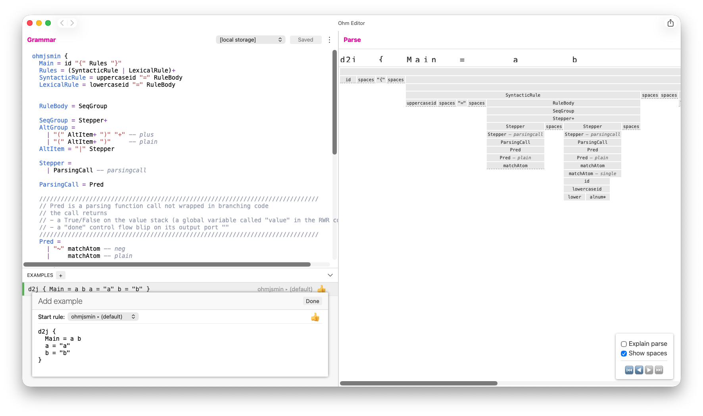

# v12
- work on Sequence with "+"
- branch SequentialItem into --plus and --plain

# v11
- begin thinking about AltGroup_plus
```
Main = ( | a | b)+
```

means
- parse an "a" or a "b" (skipping spaces)
- if successful
  - set the return values for targetid and bypass
  - then, in a sand-box not affecting the return values, repeat[*] the alternation until it fails
- if not successful
  - set the return values for targetid and bypass
  - don't try any more alternations

[*]reset bypass to False at top of while

# video 23
- use value based triggering
- 
- playlist https://www.youtube.com/playlist?list=PLLklGkLmCilw

# video 22
- heavier testing
- 
- playlist https://www.youtube.com/playlist?list=PLLklGkLmCilw

# video 21
- Stepper component
- https://youtu.be/jOTAlr7lW70
- playlist https://www.youtube.com/playlist?list=PLLklGkLmCilw

# v10
- savedtargetid instead of myid
- proceed instead of cntinue
- p and v prefixes
- skip

- vid 21

# v9
- after drawing control flow diagram in ../d2jpbp


- parser functions return true or false. If they need to provide more detail, they use `stkpush (..., ...)`
- add `from plib2 import *\n` to Main
- remove `stkpush` from pred - parsing control flow only works with booleans, other values must be pushed onto the value stack as necessary (none needed at this moment)
- add `    begin ("⦑rulename⦒")` to RuleBody
- return accept or fail
- introduce cntinue and mycntinue - a new one at each level for future compositions
- use skip to track if ohm space-skipping is needed
- use lambda when space-skipping, tested with genskipmaybe
- Stepper `‛⦑cntinue⦒ = ⦑cond⦒ «ParsingCall»’`
- AltGroup flows cntinue from above into AltItem, then flows the result back in mycntinue. Similarly in SeqGroup. Might be wasteful, but keeping a stack of bools is safer than optimizing. We might be able to apply peephole optimizations for common optimizable patterns.
- match instead of cntinue

```
           ⦑cntinue⦒ = ⦑mycntinue⦒
           «AltItem»
           ⦑mycntinue⦒ = ⦑cntinue⦒
```
# v6

# v5
- remove * and ? (YAGNI)
- flesh out SingleSeqBranchedItem_plainplus
- rm _bar
- look at Object
- indent before nonblank

# v4
- SingleSeqBranchedItem_plain

# v3
flesh out Pred rewrites


# Parser-building SCN
WIP
## Goal
convert `d2j.ohm` into Python parser
## Progress: 
- run `./@make`
- paste generated code into `test.py` (replacing only one def `main`)
- run `python test.py`
- (it parses `test.ohm` and results in `success`)
## Files
- `ohmjsmin.ohm` grammar for parsing `d2j.ohm`
- `ohmjsmin.rwr` rewrite spec for rewriting `d2j.ohm` into Python
- `plib2.py` - parser library (set `debugprogress` and `debutrace` to True to trace the parsing)
- `kernel.drawio.json` ultimate target to parse with generated parser (not tried at this point, 2026-11-04)

## Once
- if you create a new ohmjsmin.ohm, you can generate a new ohmjsmin.rwr by `./@makerwr` - be careful, since that will wipe out any the previous version of ohmjsmin.rwr

## Concessions
- parenthesized alternates must use (| ... | ...) syntax instead of ( ... | ... ) 
  - makes it easier to parse and to differentate parenthesized **sequences** from parenthesized **alternates**
- `([x|y])+` nested constructs must be written as two rules `z+` and `[x|y]`
  - nested constructs can be parsed, but are more difficult for code generation
  - separating them makes code generation easy, and forces the parser to tell us what is going on
  - nested constructs would be easy to generate if the grammar used recursion instead of Kleene+ and if it generated Lisp code (nested by default) instead of
    linear code like for Python
- alternates must be written with preceding `|`, e.g. `KVorObjectPlain = | KV | Object` instead of `KVorObjectPlain = KV | Object`
  - easier to differentiate between **sequences** and **alternates** for code generation
  - the point of parsing is not only to get away with what is possible to parse, but, also to help the code generator differentiate between cases

### Ideas
- maybe it's possible to write the parser to use `&"|"` after a MatchSequence to help decide whether the MatchSequence is part of an alternation or just a plain Sequence
- but, is it worth it? What does such "improved" syntax gain? It conflates two completely different use-cases (alternation vs. sequencing)

## Related Substack Article
[SCNs - Building Them Quickly and Easily](https://programmingsimplicity.substack.com/p/scns-building-them-quickly-and-easily?r=1egdky)
